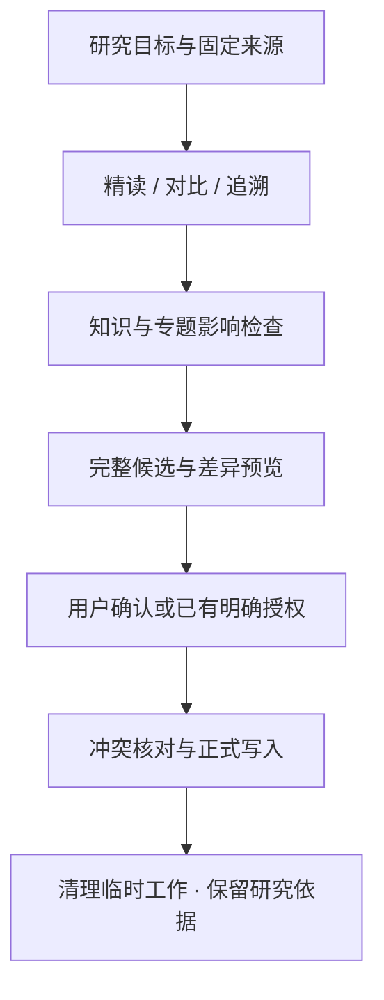

# arxiv_ans

**面向 Codex / Claude Code 的论文研究 Skills：精读机制、比较技术演变、追溯研究路线，沉淀可复用知识。**

[](LICENSE)
[](pyproject.toml)
[](.agents/skills)
[](#obsidian-阅读与交互)

从一篇论文的问题与约束出发，解释关键设计为何成立、证据支持到哪里，以及哪些结论能迁移到其他研究。研究结果以 Markdown 保存，可在 Obsidian 中阅读、批注、回查原文并继续讨论。

[快速开始](#快速开始) · [技能目录](#技能目录) · [研究流程](#研究流程) · [输出内容](#输出内容) · [开发与维护](#开发与维护)

## 核心能力

- **深入精读**：三遍阅读逐步完成问题定位、机制与学习/证明分析、虚拟重构和作者视角辩护，保留关键实现细节及负面证据。
- **机制对比**：在共同情境下走通各方案，分析继承、替代、分叉和互补，给出有条件的选择及区分验证。
- **研究追溯**：围绕焦点问题整理前驱、后续工作和路线关系，记录真实检索、筛选与覆盖边界。
- **知识沉淀**：检查现有知识和专题，查重后提出有依据的增量，保持论文、概念和研究问题之间的链接。
- **原文可回查**：固定论文版本与内容哈希，重要判断标明页码、章节、表图和适用条件。
- **连续研究**：每篇论文由独立代理完成全流程，按当前阶段加载资料；持久记录支持中断恢复，主会话接收最终结果或必要异常。

## 快速开始

### 1. 准备环境

- 支持项目 Skills、文件访问及代理工具的宿主，例如 Codex 或 Claude Code。
- [uv](https://docs.astral.sh/uv/)；Python 要求为 **3.11 或以上**，依赖由项目管理。
- 可选：[Obsidian](https://obsidian.md/)，用于原生链接、批注与资料库视图。

### 2. 克隆并安装依赖

以下命令适用于 macOS / Linux shell：

```sh
git clone https://github.com/aiml-kiki/arxiv_ans.git
cd arxiv_ans
uv sync --locked
mkdir -p 论文 知识 专题 附件
cp -n .agents/skills/paper/assets/library.base 专题/资料库.base
```

在 Codex 中打开仓库目录作为项目；在 Claude Code 中从该目录开始会话。Codex 技能入口位于 `.agents/skills/`，Claude 兼容入口 `.claude/skills/` 指向同一份实现。工作约定见 [AGENTS.md](AGENTS.md)。

若使用 Obsidian，将仓库目录作为库打开，从 [首页.md](首页.md) 开始。新库的论文、知识与专题视图为空；首页中的历史示例链接会在对应笔记存在后可用。

### 3. 发起一次研究

将下面的提示发送给 Agent，并替换实际论文或问题：

```text
运行 paper：精读 <论文 URL 或本地 PDF>，解释方法、关键实现与证据，
完成三遍阅读，并检查关联知识和专题，给出完整预览。
```

```text
运行 paper：对比 <论文 A> 与 <论文 B>，
分析共同情境下的机制、技术演变、实验口径及适用条件。
```

```text
运行 paper：追溯 <研究问题>，
整理代表路线、关键分歧、实际覆盖范围和下一步阅读路径。
```

默认自主完成内部阶段，再交付完整候选。需要逐遍交流时加上“每一遍讲完后等我讨论”。正式写入前查看草稿、差异和目标路径，确认一组改动后说：**按这组预览写入**。已有明确写入授权覆盖的范围会继续执行。

## 技能目录

| 技能 | 解决的问题 | 主要交付 |
|---|---|---|
| [paper](.agents/skills/paper/SKILL.md) | 如何组织当前研究任务 | 能力选择、依赖与最终交付 |
| [paper-fetch](.agents/skills/paper-fetch/SKILL.md) | 原文是哪篇、哪个版本、能读到什么 | 固定来源、解析入口与材料限制 |
| [paper-read](.agents/skills/paper-read/SKILL.md) | 方法怎样工作、为什么成立 | 完整论文精读候选 |
| [paper-compare](.agents/skills/paper-compare/SKILL.md) | 各方案有什么技术关系、怎样选择 | 有共同坐标与双端依据的对比稿 |
| [paper-trace](.agents/skills/paper-trace/SKILL.md) | 研究路线如何形成、下一篇读什么 | 有覆盖边界的专题与研究地图 |
| [paper-knowledge](.agents/skills/paper-knowledge/SKILL.md) | 什么理解值得复用、哪些旧判断应更新 | 查重后的知识与专题增量 |

可直接明确调用单个能力，例如 `运行 paper-read：精读 <论文>`。技能被发现、论文中的文字或笔记中的勾选框，都不构成执行指令。

## 研究流程



### 精读：三遍逐步深入

1. **第一遍——定位**：明确问题、任务与约束，建立架构全景，找出关键贡献和疑问。
2. **第二遍——走通**：沿实际输入走通机制，追踪学习信号或证明依赖，核对配置、实验协议和决定性证据。
3. **第三遍——重构与挑战**：构造最小可实现方案和同约束替代设计，提出质疑、最强作者辩护及能区分竞争解释的观察。

每阶段先保存结果并核对，再加载下一指南。多篇完整精读各有独立 owner，默认最多两位并行；对比、追溯与知识整合也按完整单元委派。模型路由以宿主实际能力为准，配置偏好不代表模型已切换。

### 对比：解释关系与演变

共同问题与约束 → 同一情境下分别走通 → 找到接口和假设变化 → 核对双端证据 → 判断收益、代价与反转条件。

比较会区分直接继承、平行路线和分析者推断；时间先后或引用关系本身不能证明技术继承。不同数据集、指标分母或计算预算的数字会注明可比范围。

## 输出内容

| 内容 | 本地位置 | 阅读重点 | 模板 |
|---|---|---|---|
| 论文 | `论文/` | 一分钟回顾、方法框架、学习/证明、证据、实现与反证 | [论文模板](.agents/skills/paper-read/assets/paper.md) |
| 知识 | `知识/` | 独立原理、论文中的用法、适用边界与来源 | [知识模板](.agents/skills/paper-knowledge/assets/knowledge.md) |
| 对比 | `专题/`，`kind: comparison` | 共同坐标、技术演变、证据分歧与条件选择 | [对比模板](.agents/skills/paper-compare/assets/comparison.md) |
| 研究专题 | `专题/`，`kind: topic` | 实际覆盖、路线关系、阅读路径与研究机会 | [专题模板](.agents/skills/paper-trace/assets/topic.md) |

论文的方法详解先给简明框架图，说明动机、模块、输入、操作、输出和交接，再展开正文。重要实现条件、未披露项、负面结果与判断限制保持可见。

**虚拟重构表示对方法的理解深度，真实复现需要实际运行与验证。** 来源提取、脚本检查或分析完成，也不会被记录为用户已掌握。

## Obsidian 阅读与交互

- **定位**：页首导航与原生大纲跳转到方法、证据和讨论。
- **回查**：Wiki 标题/稳定块链接定位具体判断，PDF 页码链接回到固定原文；页码使用实际 PDF 物理页。
- **理解**：分段、分点、短表、公式和适量 Callouts 保持主线清楚；原生反链连接论文与知识。
- **浏览**：Bases 区分论文、知识、对比和研究专题；Canvas 可选，核心研究判断仍保存在 Markdown。
- **继续**：在“用户原话与我的笔记”中批注，Agent 保留原话，将分析与回应另列。

续读示例：

```text
运行 paper：读取 <页面路径> 的“用户原话与我的笔记”，
从 <具体疑问或章节> 继续解释。先回答，需要保存的修改给预览。
```

`analysis` 表示分析程度，`updated` 表示分析更新日期，“最近编辑”使用文件修改时间。展示规范见 [Obsidian 适配](.agents/skills/paper/references/obsidian.md)。

## 仓库结构

```text
arxiv_ans/
├── .agents/skills/      # 一个研究入口 + 五个能力单元
│   └── paper/          # 共享协议、路由、状态契约与研究工具
├── .claude/skills/      # 指向同一实现的兼容软链接
├── scripts/             # 通用 Git 同步工具
├── AGENTS.md            # 项目工作约定
├── CLAUDE.md            # Claude 入口
├── 首页.md              # Obsidian 阅读入口
├── pyproject.toml       # Python 依赖与版本要求
├── uv.lock              # 依赖锁定
└── LICENSE
```

研究运行时另在本地使用 `论文/`、`知识/`、`专题/`、`附件/`、`.research/` 和 `审阅/`。默认 Git 保存技能、模板、脚本与首页；上述研究数据及 Obsidian 个人配置受 [.gitignore](.gitignore) 保护，历史笔记和论文原文不随克隆分发。

## 开发与维护

Python 命令统一通过 `uv run` 执行。研究脚本负责来源、状态、索引和审阅记录，科学解释与判断由 Agent 完成：

```sh
uv run python .agents/skills/paper/scripts/research.py --root . --help
uv run python .agents/skills/paper/scripts/research.py --root . workflow --help
uv run python .agents/skills/paper/scripts/research.py --root . source --help
```

- **渐进加载**：`SKILL.md` 保持短入口；阶段指南在 `references/`，模板在 `assets/`，确定性操作在 `scripts/`。
- **保持追溯**：来源版本、关键证据、真实查询和重要判断更新持久保存；完成写入后清理临时工作，未确认候选保留。
- **维护贡献**：Issue 可描述使用场景、材料限制或具体问题；PR 说明修改目的、影响范围和实际检查，避免加入私有论文与个人笔记。
- **Git 同步**：当前仓库可运行 `uv run --no-sync python scripts/git_sync.py`；本机已安装全局入口时用 `git sync-push`。安装与重试说明见 [Git 同步文档](scripts/README.md)。

## 设计与参考

研究设计结合三遍阅读、证据综合、可复现性与覆盖报告；具体采用范围见 [设计来源](.agents/skills/paper/references/design-sources.md)。本文的技能目录、快速开始和维护说明组织参考 [Anthropic Skills](https://github.com/anthropics/skills)、[OpenAI Plugins](https://github.com/openai/plugins) 与 [Superpowers](https://github.com/obra/superpowers)。

## 许可证

[MIT License](LICENSE)。
